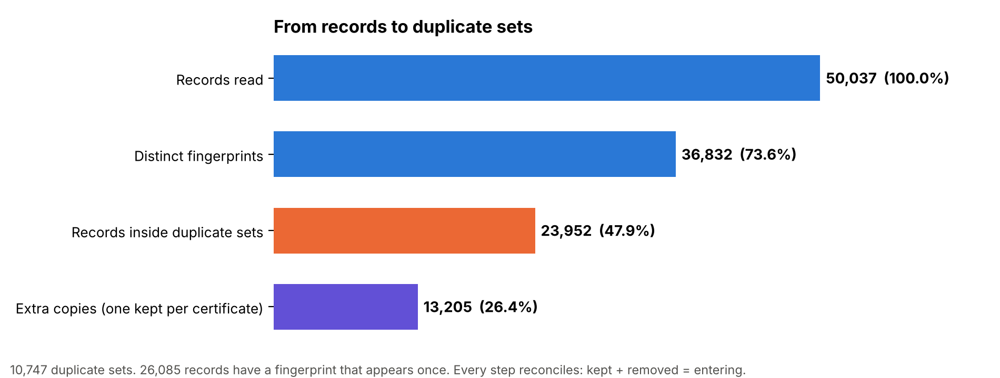
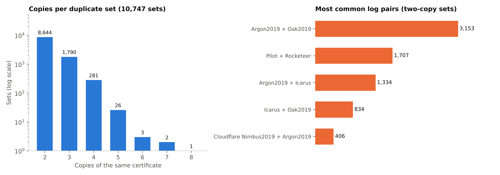

# Exercise 1: finding duplicate certificates in Certificate Transparency logs

**Problem.** Certificate Transparency (CT) is a set of public logs where every website certificate must be recorded. Several logs, run by
different operators, record the same certificate, so the same certificate appears more than once in a feed. Given a large file of CT records
(one JSON object per line), find the duplicates using the **leaf certificate fingerprint** (a code that identifies one specific certificate)
and output each duplicate set with the **complete original records**. The method must run in limited memory, because the real input is far larger than memory.

> The data in this repository is **synthetic**: random bytes shaped like certificates, with generated names. It was built to match the
> original input's structure (set sizes, precertificate/final split, log mix, log pairs, share of duplicates). See `code/synth_ex1.py`.

## Result on the synthetic file

| | |
|---|---:|
| Records read | 50,037 |
| Rejected as bad data | 0 |
| Distinct fingerprints | 36,832 |
| Duplicate sets | 10,747 |
| Records inside duplicate sets | 23,952 (47.9%) |
| Singletons (fingerprint appears once) | 26,085 |
| Extra copies (records beyond one per certificate) | 13,205 (26.4% of input) |
| Peak memory (index, grouping, pairs) | 38 MB |

Set sizes: 2 copies: 8,644, 3 copies: 1,790, 4 copies: 281, 5 copies: 26, 6 copies: 3, 7 copies: 2, 8 copies: 1. Every set is all precertificates (6,926 sets, 64.4%) or all final certificates (3,821 sets, 35.6%); none mixes the two.
The most common log pair is Argon2019 with Oak2019 (3,153 two-copy sets).
10,099 precertificate and final-certificate pairs share a serial number, names and validity but have different fingerprints, so they are counted and reported, not merged.




## How it works

1. **Leaf index.** Read the file once. For each record keep a small pointer: cleaned fingerprint, line number, byte position, and a few facts used for the audit. The large `chain` field is never kept. Pointers are written into 256 bucket files by the first two hex characters of the fingerprint.
2. **Group.** Load one bucket at a time (largest here: 243 rows) and find fingerprints that appear more than once. Memory stays flat as the input grows.
3. **Fetch and write.** For duplicate sets only, read the original lines by position and copy them **byte for byte**, so every field survives by construction.
4. **Audit.** Counts per step, per log, per set size, precert/final pairs, and five invariants (for example raw lines = staged + rejected, staged = singletons + output records). Any failed check means the input is not what the script expects.

## Run it

```
gunzip -k data/synthetic_ct_records.jsonlines.gz
python code/dedup.py --input data/synthetic_ct_records.jsonlines --out-dir out --work-dir work --skip-output      # audit only, fast
python code/summarize.py --audit out/audit.json --out audit_summary.md                                              # one-page summary
python code/dedup.py --input data/synthetic_ct_records.jsonlines --out-dir sample --work-dir work --output-sample 1000
python code/verify.py --input data/synthetic_ct_records.jsonlines --out-dir sample                                  # byte-for-byte check
bash code/recount.sh data/synthetic_ct_records.jsonlines                                                            # independent recount
```

`dedup.py` also reads `.gz` input directly and can resume an interrupted index (`--max-seconds`). Python 3.9 or newer; standard library only.

## How the numbers were checked

- **Independent recount.** `code/recount.sh` extracts fingerprints separately and counts with `sort | uniq -c`. It matches the pipeline on records, distinct fingerprints, singletons, sets and every set size (`results/independent_recount.txt`).
- **Byte-for-byte sample.** `code/verify.py` confirmed 977 output sets in `results/sample/` are identical to their input lines.
- **Edge cases.** `code/make_edge_test.py` builds a file with CRLF line endings, a blank line, non-ASCII text, truncated JSON and a fingerprint written without colons, to test how the script rejects or handles each.

## Decisions and why

See [`docs/decisions.md`](docs/decisions.md). The main ones: strict leaf-fingerprint grouping only; copy original lines instead of rebuilding them; a pointer index instead of full rows in the buckets (about 25 times less temporary disk); report precert/final pairs instead of merging them.

## Limits and open questions

- Whether a precertificate and its final certificate should count as duplicates is a question for the data owner; this code reports them as pairs.
- The full duplicate output of a very large file can itself be tens of gigabytes. The repository keeps an audit summary, the reproducible command and a verified sample instead.
- Memory was measured, not targeted, because the exercise gave no number.
- The synthetic certificates are not valid X.509 certificates; the fingerprint is the SHA-1 of the stored bytes, as in the real format.

## Files

| Path | Contents |
|---|---|
| `code/` | `dedup.py` (pipeline), `verify.py`, `summarize.py`, `profile.py` (profile a file), `make_edge_test.py`, `recount.sh`, `memrun.py` (peak memory), `synth_ex1.py` (data generator) |
| `data/` | Synthetic input, gzipped |
| `results/` | `audit.json`, `audit_summary.md`, `independent_recount.txt`, `sample/` (verified duplicate sets) |
| `visuals/` | Charts |
| `executive_summary.pdf` | One page for readers in a hurry |
