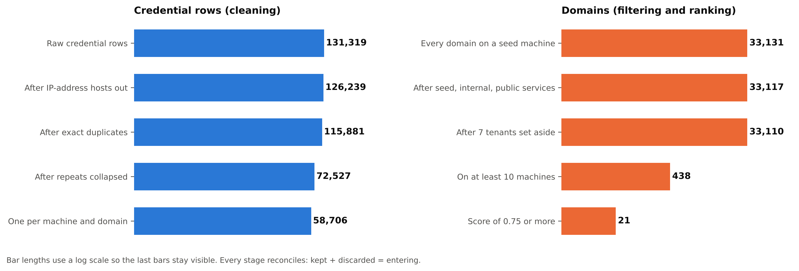
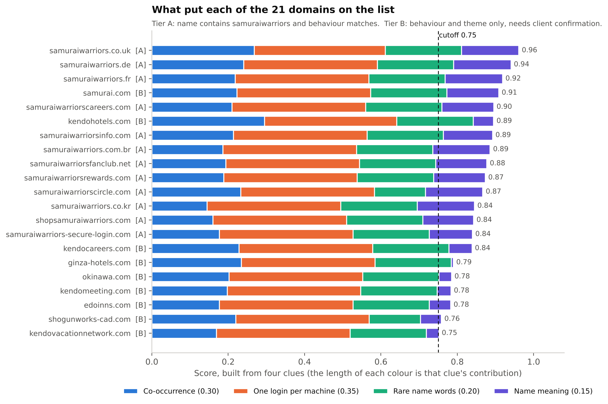

# Exercise 2: recommending domains a client probably owns, from stolen-credential logs

**Problem.** A file lists saved logins that malware collected from 560 infected computers. Each row is one saved login (a website and
login page), with details of the infected machine repeated on every row. There are no usernames or passwords. One domain, the **seed**
(`samuraiwarriors.online`), is known to belong to a client. Recommend other domains the same client probably owns: ranked, each with evidence a colleague could dispute.

> The data here is **synthetic**: rebuilt to match the structure of the original dataset (machines, rows per machine, repeated rows,
> domain counts, the share of public services). Company and domain names are fictional or generic, except well-known public services
> (Spotify, Roblox and similar) which appear as ordinary examples of consumer sites. Nothing here is evidence about a real organization.
> These are **initial recommendations for discussion**, not confirmed ownership.

## Try it

**[Score Clue Explorer](https://rwsiegel.github.io/data-engineering-case-studies/)** (also in `score_clue_explorer.html`): move four sliders and see the ranking change. See [Publishing the explorer](../README.md#publishing-the-explorer).

## Headline results

| | |
|---|---:|
| Saved-login rows read | 131,319 |
| Observations (one per machine and domain) | 58,706 |
| Candidate domains | 33,131 |
| Domains with enough evidence to score (seen on at least 10 machines) | 438 |
| **Recommended (score 0.75 or higher)** | **21** (12 tier A: name contains the seed name; 9 tier B: behavior and theme only) |
| Review leads (score 0.70 to 0.75, one login per machine) | 2 |
| Third-party tenants set aside as "related, not owned" | 7 |
| Independent recount | 10 of 10 checks pass |
| Evidence audit against the raw file | 13 of 13 checks pass |




## Method in one page

- **The unit of evidence is the infected machine, not the row.** One machine with 900 saved logins is still one machine. Each (machine, domain) pair becomes one observation with its row counts carried forward.
- **Name similarity is not ownership.** Anyone can register a similar name. So the name carries 35% of the score, and a domain is never ranked on its name alone.
- **A domain the client already has is not a recommendation.** The seed is removed. Third-party services where the client is a tenant (an identity provider, a careers-site host) are set aside as related, not owned.
- **No labels exist**, so quality cannot be measured and a trained model would only fit guesses. The ranking is a transparent score with four named clues, so every position can be explained and disputed:

| Clue | Weight | What it measures |
|---|---:|---|
| Seen on many machines | 0.30 | log of the number of machines that hold a login to the domain, so very small counts earn little |
| One login per machine | 0.35 | a company's own site tends to hold one account per person; consumer services hold several |
| Rare name words | 0.20 | share of the name's words found in 15 or fewer domains (generated filler names reuse stock words) |
| Name meaning | 0.15 | closeness of the name's words to the seed's words in a word-vector table (GloVe) |

Domains seen on 35% or more of machines (public services) and on fewer than 10 machines (too little evidence) are removed before scoring.

## How robust is it

- **Weight changes.** Changing each weight by up to 50%, at random, 2,000 times keeps 20.18 of the 21 on average (worst trial: 15). Every tier A domain stayed in at least 99.6% of trials.
- **Drop one clue at a time.** Removing one login per machine replaces 8 domains (consumer services such as Apple, Spotify and Roblox enter). Removing any other clue replaces 1 to 2.
- **Cutoff.** Cutoff 0.65 gives 42 domains, 0.70 gives 27, 0.75 gives 21, 0.80 gives 15, 0.85 gives 11.
- **Repeated rows.** The same machine, host and login page appears several times (21,126 groups hold 77,532 rows); only the download time differs, by under a second. The cause cannot be known without a credential identifier. Counting each distinct login page once instead keeps 15 of 21 (`evidence.py --login-count urls`).
- **Clustering.** HDBSCAN (a density-based grouping method) on machine behavior and name meaning finds two small groups (generated filler domains; domains with many logins per machine) and puts all 21 recommended domains in "noise", so clustering did not find a better list or a missed domain.

## Run it

```
gunzip -k data/samuraiwarriors_credentials.csv.gz
mkdir vectors && curl -L -o vectors/glove50.gz https://github.com/piskvorky/gensim-data/releases/download/glove-wiki-gigaword-50/glove-wiki-gigaword-50.gz
cd code
python clean.py      --input ../data/samuraiwarriors_credentials.csv --out-dir out
python candidates.py --out-dir out
python semantic.py   ../vectors/glove50.gz out
python evidence.py   --out-dir out --top 30
python package.py    --out-dir out --final-dir final
python recount.py    --input ../data/samuraiwarriors_credentials.csv --out-dir out --final-dir final
python stability.py  --out-dir out
python cluster_experiment.py --out-dir out
python validate.py   --input ../data/samuraiwarriors_credentials.csv --out-dir out --final-dir final --report final/validation_report.md
```

Python 3.9 or newer with `numpy`, `pandas`, `scikit-learn` (1.3 or newer for HDBSCAN), `scipy` and `matplotlib` (`pip install -r ../requirements.txt`). The stages are described below; `results/` holds the output of this exact run.

## How the stages fit together

1. **Parse and normalize (`clean.py`).** Reverse hostnames written backwards (`com.kendohotels.` becomes `kendohotels.com`; logged in `repair_log.csv` as a repair, not a discard), lowercase hosts, drop IP addresses and invalid hosts, reduce each host to its registrable domain (a small built-in list of second-level labels stands in for the public suffix list). Collapse repeats to one **observation per machine and domain**, the unit of evidence, while carrying the counts. Every stage reconciles: kept + discarded = entering.
2. **Candidate generation and filters (`candidates.py`).** Every domain seen on a seed machine is a candidate. Filters, each logged by name: the seed itself; internal or non-public names (set aside); widespread domains seen on at least 35% of machines (public services).
3. **Name meaning (`semantic.py`).** Splits names into words, strips the 21 generic business words, and measures distance to the seed's name in a pretrained word-vector space (GloVe).
4. **Evidence and ranking (`evidence.py`).** Sets aside third-party tenants (a host under another provider's domain carries the seed name). Gates on at least 10 machines. Score = 0.30 co-occurrence (log of machine count) + 0.35 one login per machine + 0.20 rare name words + 0.15 name meaning. Name parts total 0.35, so a name alone cannot top the ranking. Levenshtein distance and distance from the public-service profile are reported with each domain but not scored.
5. **Package (`package.py`).** Domains scoring at least 0.75 are recommended; domains scoring 0.70 to 0.75 with one login per machine are review leads. Writes the combined discard log and the funnel.

## Deliverables in `final/`

| File | Contents |
|---|---|
| `recommendations.csv` | Ranked domains with score, evidence fields, a plain-language reason, example hosts and URLs |
| `review_leads.csv` | Domains just below the cutoff that need a human look |
| `evidence_machines.csv` | Every supporting machine (`log_id`), host and URL for each recommended domain and lead |
| `related_not_owned.csv` | Third-party providers where the client has a tenant (not client-owned) |
| `discard_log_all.csv` | Every discard and set-aside at every stage, with reason, counts and examples |
| `funnel.md` | Counts at each stage from rows to recommended domains |

## Known limits

- No labels exist, so ranking quality cannot be measured; whether the recommended domains are client-owned is untested.
- Several signals (rare name words, the 21 generic words, one login per machine) reflect how this synthetic data was generated; real data would need them re-derived.
- The one-login clue rewards exactly 1.0 logins per machine, while the seed itself holds 1.83. Scoring closeness to the seed's value instead keeps only 3 of the 21. It is a hypothesis, not a finding.
- Machine country is independent of a domain's country ending in this dataset, so it is not used.
- A small built-in suffix list replaces the public suffix list; a production run should use the real list.
- The word-vector model is an external dependency.
- The weights and the 0.75 cutoff are judgment, tested for stability but not tuned against labels.

## Files

| Path | Contents |
|---|---|
| `code/` | the pipeline stages, `recount.py` and `validate.py` (independent checks), `stability.py`, `cluster_experiment.py` |
| `data/` | synthetic credentials file, gzipped |
| `results/final/` | ranked recommendations, review leads, evidence per machine, related-not-owned list, discard log, funnel |
| `results/stages/` | per-stage summaries, discard and repair logs, every scored candidate, stability and clustering results |
| `results/validation/` | validation report and recount output |
| `visuals/` | charts |
| `relationship_sketch.mmd` | diagram source for how domain relationships could be stored over time |
| `docs/` | `decisions.md`, `worked_example.pdf` (why one domain is listed and a popular one is not), `commentary.md` |
| `executive_summary.pdf` | one page for readers in a hurry |

## Column dictionary for `recommendations.csv` and `review_leads.csv`

| Column | Meaning |
|---|---|
| `rank` | Position by score among the 438 domains that passed the gate |
| `domain` | Registrable domain (for example `kendohotels.com`); subdomains are merged into it |
| `score` | 0 to 1: 0.30 co-occurrence + 0.35 one login per machine + 0.20 rare name words + 0.15 name meaning |
| `machines` | Distinct infected machines (`log_id`) with at least one saved login on this domain |
| `machine_share` | `machines` divided by the 560 machines in the data |
| `logins_per_machine` | Saved-login rows for the domain divided by `machines`. 1.0 means each machine has one login; consumer services run 1.6 to 6.6 |
| `name_words` | How the name was split into words (`kendo+hotels`) |
| `name_similarity_to_seed` | Cosine similarity in the GloVe word-vector space between the domain's brand words (generic words removed) and the seed name "samurai warriors". 1 means the same meaning, 0 means unrelated |
| `levenshtein_to_seed_brand` | Single-character edits needed to turn the brand text into `samuraiwarriors`. 0 is identical; larger is further. Reported, not scored |
| `rare_word_share` | Share of the name's words that appear in 15 or fewer domains in the data. Generated names use common words (hundreds of domains each), so a high value points to a hand-written name. A dataset artifact |
| `seed_stem_in_domain` | 1 if the domain contains `samuraiwarriors`. A flag, not proof |
| `distance_to_public_profile` | Distance in standardized units between the domain's (machine count, logins per machine) and the average of the 9 widespread public services. Larger means less like a public service. Reported, not scored |
| `why` | The reasons in plain language |
| `example_hosts`, `example_urls` | Up to 5 hosts and 3 URLs seen for the domain |
| `evidence_tier` | A: carries the seed name and matches the behavior. B: behavior and theme only; confirm with the client |
| `status` | `recommended` (score at least 0.75) or a review lead |

`evidence_machines.csv`: one row per machine and domain: `log_id` (full machine ID), `credential_rows` (saved logins on this domain from this machine), `distinct_fqdns`, `distinct_urls`, `example_fqdn`, `example_url`.
